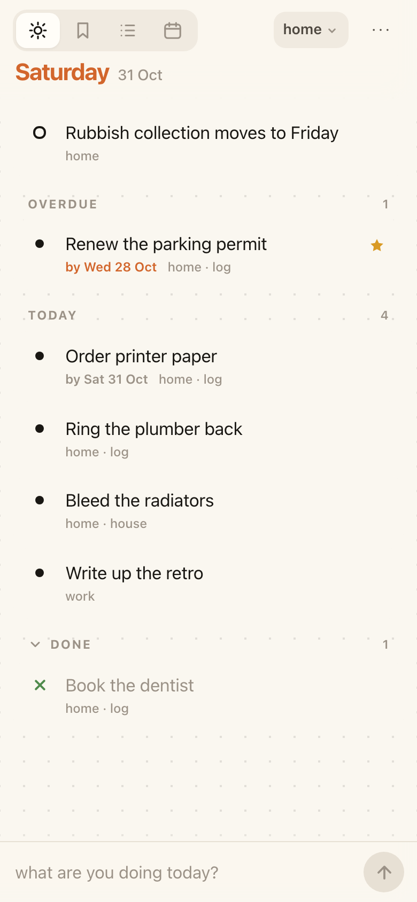
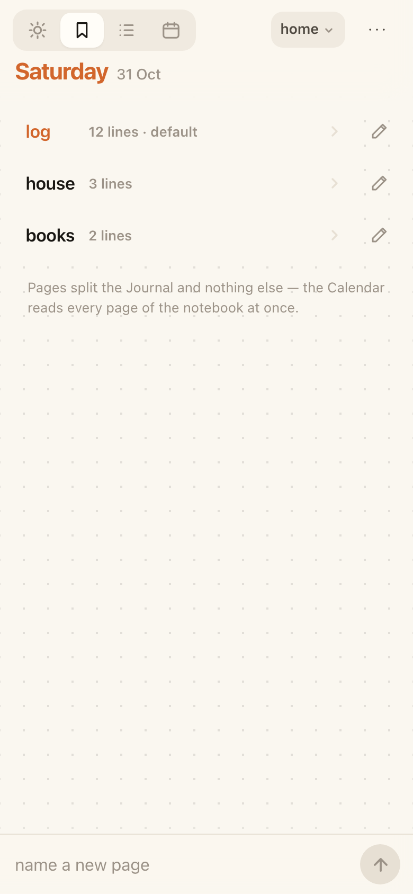

# bujo

A touch-first bullet journal built for a thumb, live at
**https://mohdejaz.github.io/bujo/**. Add it to your home screen and it works
offline.

| Today | Journal | Calendar | Index | A line, opened |
| :-: | :-: | :-: | :-: | :-: |
|  |  |  |  |  |

Four pages. **Tasks** share one endless *Journal*. A task needs no date —
most are just things to do, and those read newest first — but it can carry a
day it is wanted **by**, and then it sorts by that: anything overdue at the
top, then the soonest day, with the undated work below. **Events have a date**
and live on the *Calendar*, grouped by day — and whatever falls on today is
printed at the head of the Journal, so the page you open shows what is on as
well as what is outstanding. The **Index** is the notebook's own contents:
every page of it, with how many lines are on each, and a tap to turn to one.

**Today** is the page the app opens on, and the only one that is not about a
place: every other page narrows the journal by where a line lives, and this
one narrows it by the day, reading across *every* notebook and *every* page at
once. What falls on today, what is due today or already past, and whatever you
put there by hand — a mark that records the day you made it, so midnight takes
it off again by itself. Every row names the notebook and page it came from.
Switching between the four is the only navigation there is.

The row prints only its words — and its deadline, when it has one. The day a
line was written is in its sheet, a tap away, rather than on the page.

Tap a bullet to complete, swipe right to complete, swipe left to set a task
aside in the backlog. Every line carries its own long-form notes — there is no
free-standing note, because what you want to remember belongs with the thing it
is about — and several notebooks can sit side by side, each with its own pages
listed on the Index. The Journal names the page it is reading beside the date,
so the lines under it are never anonymous; Today, which reads past both, names
the notebook and page on each line instead. The journal lives in `localStorage` on the device and is
exported and imported as JSON from the ⋯ menu — that export is the only backup,
so take one now and then.

A journal written in the previous, dated version of this app is migrated once,
automatically, the first time this one opens; the old data is left on the
device untouched as a backup. See
[the migration table](web/README.md#coming-from-the-dated-journal) for exactly
what moves where.

No build step, no dependencies, no account.

## Running it

The app is [`web/`](web/) — five files and three PNGs, served by any static
host. Locally:

```sh
cd web
./serve.sh          # prints the LAN URL; open it on your phone
./serve.sh 9000     # or pick a port
```

*Add to Home Screen* and offline mode need HTTPS or localhost, so over the LAN
you get the app but not the installable layer. Pushes to `main` that touch
`web/` deploy to GitHub Pages automatically.

See [`web/README.md`](web/README.md) for the full guide: gestures, due dates,
the backlog, notebooks and their pages, the Index, search and the data
format.

## License

MIT — see [LICENSE](LICENSE).
