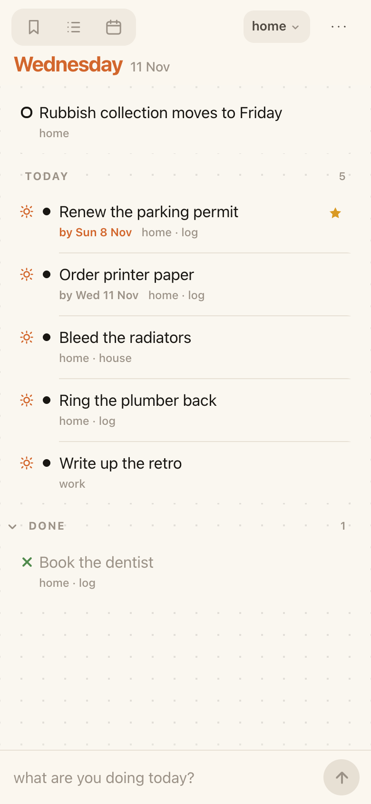
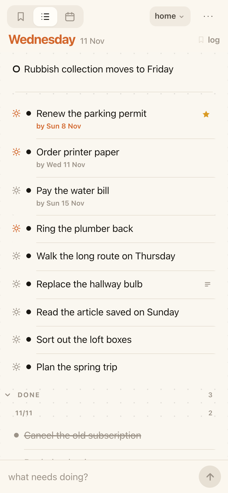
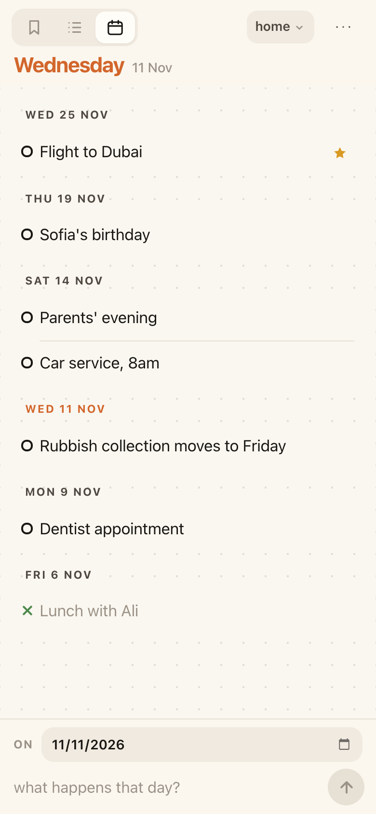
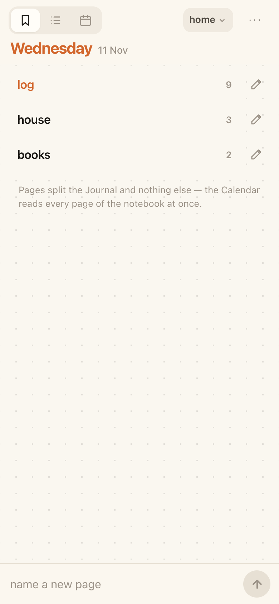
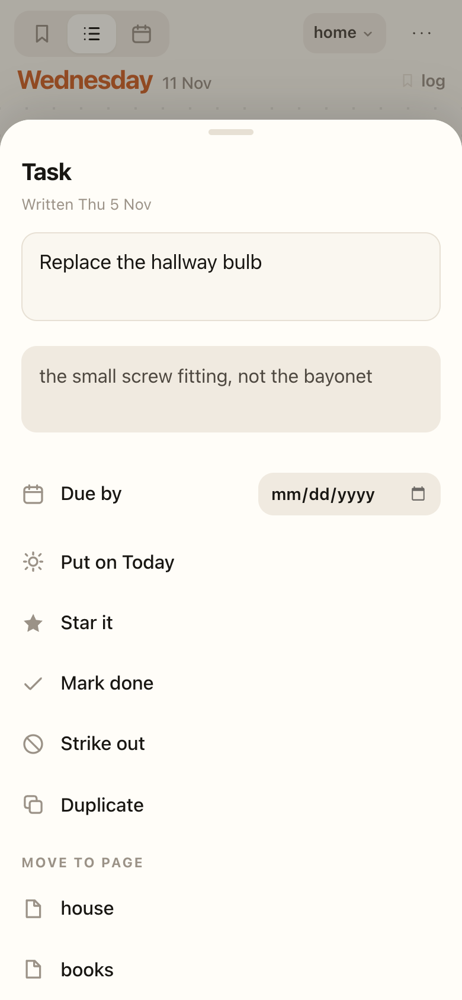

# bujo

A touch-first bullet journal in four pages. **Today** gathers what this day
holds, from every notebook at once; tasks sit on a page of the **Journal** and
may carry a due date; events have a date and live on the **Calendar**; the
**Index** lists the pages of the notebook and turns to any of them. A page of
the notebook can also be a **page of notes**, for the things you want to keep
rather than do, a **page of q&a**, where you write what you want to know and
the answer goes on the same line when you have it, or a **page about one
person**, where what you have noticed about them is filed under the day you
noticed it. Switching between the four is the only navigation there is.

No build step, no dependencies, no account. The journal lives in
`localStorage` on the device.

| Today | Journal | Calendar | Index | A line, opened |
| :-: | :-: | :-: | :-: | :-: |
|  |  |  |  |  |

All five are the light theme — paper; there is a dark one too, the same page
at night. The screenshots are taken from a seeded journal, not a real one.

## What it is

```
  •  a task        something to do, whenever — or by a day
  ○  an event      something that happens, on a day
  –  a note        something to keep, on a page of notes
  ?  a question    something you want to know; the answer reads under it
  ▪  an observation something you noticed about someone, on their own page
  ×  done
  ≡  carries notes
```

Every row starts with the same one-rem column holding that mark, so the words
line up down the whole page whichever list you are reading, and the mark is
always a thumb away. A page of q&a is the exception and drops the column
altogether — every line on it is a question, so a column of identical marks
would say nothing, and the `?` at the end of the words has already said it. Its
mark is for where the kinds mix: beside a page's name in the Index, and against
the other three in a search. A task struck out keeps its `•`, dimmed and ruled
through: that is a line you decided against, not a state of the work.

Four kinds of line, and the page you are on decides which you are writing. A
**task** goes on a page of work in the Journal, newest first, until you drag it
somewhere else or give it a day it is wanted by. The row prints only its words and that day,
if it has one; the day the line was written is in its sheet. A row is **one
line high whatever is on it** — words longer than the width end in `…` rather
than wrapping, so what a line costs on the page does not depend on how much
was typed into it, and the whole of it is one tap away in its sheet. An **event**
always carries a date, and that is what makes it an event; it goes on the
Calendar. A date and no clock — an event is placed on a day, and the day
heading it sits under says which.

Three more kinds of line are not about doing anything at all. A **note** is
something you wrote down to keep — a number, a name, what somebody said — and
it lives on a **page of notes**, and its words are the whole of it: there is no
second box underneath, for the same reason a question has none.

A **question** is the other: where the water shut-off is, what the wifi is,
which day the bins go out. It lives on a **page of q&a**, and it carries its
own **answer** — so the row prints the question
with the answer directly beneath it, in the same type, because the two are one
line of the notebook rather than a line and a footnote. Only the ink steps back
a shade, which is enough to let the questions lead the scan. The question is
prefixed `q:` and the answer `a:`, and both wrap in full, as do the lines of a
page of notes, rather than being cut off with an ellipsis. Nothing can pull
the pair apart: they are one entry, and an unanswered question is simply a line
on its own with nothing under it yet. Nothing is stored for being answered:
having an answer *is* being answered.

A question carries no deadline and never reaches Today, because nothing on it
is owed on a day. It is also the one line with no `×`: a question is struck out
when it stops being worth asking and deleted when it was never worth writing,
and answering one is filling it in rather than finishing it.

A **page about one person** is the third. Its name is their name, and the lines
on it are what you have noticed — what they said, what they are up to, what
they are worried about. It is a page of the notebook and not an address book:
there is no field on it for anything, nothing on it is a contact detail, and
one page is one person.

What is on it is filed under **the day you wrote it**, newest day first, under
the same day heading the Calendar uses. That is the whole shape of the page,
because an observation is worth what it is worth *when* it was made — "moving
teams" means one thing said last week and another said in March — and a person
is read backwards from what they are doing now. You never set that day: it is
when the line arrived.

Nothing about a person is owed on a day, so an observation carries no deadline
and never reaches Today, exactly as a question does not. It is struck out when
it stops being worth remembering and deleted when it was never worth writing.
A thing you have to *do* about someone is a task and belongs on a page of work
— their page holds what you noticed, not what you owe them.

Unlike the other three kinds, a page about someone has no default. Nothing ever
lands on one by absence: an observation is written on that person's page or not
at all.

A note and a question are close enough that choosing between them is about how
you will read it back. A note says what it is; a question says what you were looking for when
you come back needing it. *Bin night is Wednesday* and *Bin night? —
Wednesday* hold the same fact, and the second is the one you scan for. Notes
when the page is a list; q&a when the page is something you consult.

A task is something to do whenever, or by a day; an event is something that
happens on a day; a note is something you keep; a question is something you
want to know; an observation is something you noticed about a person. A line
never moves
between the pages — changing what kind of thing it is would be writing a
different line — though the Journal does *show* you today's events, at the top,
where they are hard to miss.

Two of the four pages hold no lines of their own. The **Index** is the
notebook's own contents, and the way to turn to another of its pages.
**Today** is the one page that is not about a place at all: every other page
narrows the journal by where a line lives — which notebook, which page, which
kind of line — and Today narrows it by *when*, so it reads straight across
all of them.

**A task and an event carry their own notes** — open one and write underneath
it — so the detail behind a thing lives with the thing rather than floating
loose. A line that holds notes is marked `≡`; the notes themselves never appear
in the list, because a line of work stays one line.

The two prose kinds carry none, and for the same reason both ways round. What a
question has to say under itself *is* the answer, and a box below that would
only ever have held a note about the answer. A note's words *are* what you kept,
and a box below them a note about a note. Either way it is the same thought,
written somewhere the row cannot print it — so a note's sheet and a question's
are the words and nothing under them but the answer, and neither ever carries
the `≡`. A note written on an older build arrives with its notes folded into its
words, a blank line between, so nothing that was written is lost.

## Using it

**Writing.** Type at the bottom and press return. Almost nothing to pick:
a page of work writes a task, a page of notes writes a note, a page of q&a
writes a question, and the Calendar
writes an event and asks for the day it falls on, because an event without one
is not an event. The Calendar reads back
from the furthest day towards the oldest; several events on one day sit
newest-written first.

**Writing on Today.** Today is on no page, so there is nothing there to say
what the field writes — and it writes a **task**, which is the one kind of line
a day is owed. It arrives already marked for today, on the notebook's **default
page of work**: Today belongs to no page, and whichever one the Journal was
last showing is where you happened to be, not an answer to where the line goes.
Which notebook it goes to is the one named in the header — on this page that
button means not what you are reading but where a line you write now will go.

Nothing else can be written here. Anything that is not a task would land on a
page you are not looking at, and the field would have to tell you where it had
gone — a line you wrote and then had to read a receipt for. Turning to the page
is what that is for, and the page is one tap away.

**Gestures.** Tap a line's mark to complete it or, on one already finished,
to reopen it. Tap the text to open everything else — on a question with no
answer yet that opens straight onto the answer, keyboard up, since it is the
one thing the line is waiting for. Swipe a row **right** to finish it — a question has no finish,
so its row does not travel that way at all. Swipe it **left** a short way and it stops against a tray of two
actions; carry the swipe **all the way left** and it goes straight past them
and strikes the line out — which is the tray's own first button, so the swipe
is the quick way to it and the tray the deliberate one, the same pairing the
bullet and the right swipe already make for finishing. A row with a tray open
is shut by tapping it, or by touching any other row — only one is ever open.

**The tray.** Under the right edge of every line you can still act on — the
Journal's live work, Today's wanted lines and the questions on a page of
questions — in the order you reach for them:

```
  ⊘  strike out      ⧉  duplicate
```

Finishing is not among them: the bullet's tap says it and so does the right
swipe, and a third door onto it here would read as one more thing the left
swipe might be about to do. Two also leaves more of the words showing
beside the open tray — each button costs a thumb's width of them.

**Quick actions.** A task you are working on carries a **sun** at the head of
the row, before its mark, which puts the line on Today (lit while it is on;
tap again to take it off). Only the open lines: one already finished has no
next day.

A row without a sun holds nothing in its place, so the rows in Done begin at
the edge of their cards and the work in progress is the one bucket indented. That indent
is the sun, not decoration: the rows you can still do something about are the
rows that step in. The mark itself is always the same step from the words it
belongs to, which is why the sun leads rather than sitting between them.

The sun says whether the line is on Today, not whether you put it there — so
it is lit on every line of the **Today** page, and tapping it takes that line
off, whatever carried it on. For a line you marked, dropping the mark is
enough. For one the calendar sent — due today, or late — the deadline is
still true and would simply put it back, so the tap records that you said
*not today*, and that is all it records: **the deadline itself is never
touched**. The dismissal keeps the day it was made, the same way the mark
does, so midnight ends it and a line still owed is back tomorrow.

**The work has no heading.** Open the Journal and every open task on the page
is simply there, under the date, in deadline order — naming that pile would
only have told you the lines under the name were the lines you were already
reading, and a fold over it would have hidden the one thing you came for.
Today's events still lead, with a hairline closing them off from the work
where both are on the page.

**One stack of open work.** There is no second pile for the lines you are not
getting to yet. A task you have not finished with is a task you have, whatever
you think of your chances this week, and a bucket for the ones you had admitted
that about only moved the deciding from the line to the pile — where it
stopped being read at all. So the page is the open work and then what you have
finished with, and the ways out of the first are the real ones: finish it,
strike it out, or give it a day.

**One line to a row.** Lines are divided by a hairline rather than by a gap,
the way a mail list does it: it starts where the words start — after the sun
and the mark, not under them — and runs flush to the other edge, so the
column of marks stays clear down the page and the rule divides only the text
it is dividing. The inset follows the row, so it sits further in on the work
in progress, which leads with a sun, than on the Done, which does not. Only
between — never above the first line under a heading, which the heading has
already closed off, and never below the last. A row is the same paper as the
page it sits on, so without the rule a column of one-line rows had nothing but
space saying where one line ended, and space is the first thing a long list
takes back.

**Folding.** The one heading below the work — *Done* — is a fold: tap the word
to put its lines away, and the chevron beside it turns to say which way it is
set. The count stays either way, so a closed bucket still says how much is in
it. Done opens each time you come back; what you fold away is forgotten when
you leave, since a fold you did not set this session is a trap. Today's own
heading does not fold — what is on that page is there because of the day,
which is not a pile to put away.

**Due dates.** A task does not need one — most are just things to do — but
open a line and you can give it a day it is wanted **by**, and take it off
again with *Clear*. The row then prints that day under its words, in orange
once it is past. The work reads by deadline — anything overdue at the top,
then the soonest day, then the rest, with every undated task below the dated
ones. A date is the one order on the page you do not set
by hand: a line climbs as its day comes. Done is the record rather than the
work, so neither the star nor the deadline sorts it — what arranges it is the
day each line was settled on.

**Done, by the day.** Under the one *Done* fold the record is split by day,
most recent first, with each day's own heading and how many lines it holds.
The date reads short there — `11/05`, and `11/05/2025` once it is not this
year — because it is a stamp repeating down the page rather than a day being
named; everywhere else in the app a date still reads `Sat 21 Nov`. Within a
day the lines read back from the one settled last, the order the day actually
went in. A line finished before the app recorded settling dates is filed under
the day it was written, which is where it already sorted.

**Reordering.** Hold a task still for a moment until it lifts, then drag it up
or down. A line moves within its own bucket — the work, or Done — and only
among the rows the sort would leave it beside, since anything that crossed a
line the sort draws would be put straight back. In the work those lines are
the star and the day, so a dated task drags among the tasks due the same day
and a starred one among the starred. In Done the line the sort draws is the
day, so a finished task drags among the ones settled
beside it — carrying one across a day heading would say it was finished on a
day it was not. A line you write afterwards still lands at the top.

The same hold and drag works on **Today**, among the same runs: the lines you
marked by hand carry no date between them, so they drag end to end, and a
dated line moves among the ones owed on its day. A line has one order wherever
it is read, so arranging the day arranges the page the line lives on too —
which is the point, not a side effect: you ordered that work once.

**Notes on a line.** Tap a line to open it and write underneath — links, the
detail, the questions behind it. Strike a line out when it stops being worth
keeping; delete it when it was never worth writing.

**Today.** Tap the date at the top of any page and you get the day you are
standing in, read from *every* notebook and *every* page at once — because a
day is one day whichever journal a line was written in, and having to visit
four pages of two notebooks to find out what today holds would be a worse
notebook, not a tidier one. The date carries it rather than a tab: the tabs
switch between pages *of the notebook*, and Today is the one page that belongs
to no notebook, so it hangs off the one other thing in the header that belongs
to none either. It lights while you are on it, the way a tab does. Four things
land on it: an **event dated today**, a **task due today**, an **overdue
task** — one whose day has passed and is still open — and a **task you marked
for today** by hand, from its sheet. The events lead, under the date stamp
that names the day they fall on; then *Today*, with the overdue at its head
and their dates in orange, then a folded *Done* — what the day came to. You
can also write on it: see **Writing on Today** above.

**Only the overdue carry over.** A deadline is a claim on every day after it
until it is met, so a late task follows you onto Today from whichever notebook
and page it lives on, and stays until you finish it, strike it out or take it
off for the day. Finished today, it moves to Today's *Done* and is gone
tomorrow. A hand mark does not carry over: a task you marked yesterday and did
not finish
starts today off the page — you put back what you still mean to do, one tap
from its sheet.

Because it reads across everything, every row says where the line actually
lives: the notebook, and the page of it, but only the part you could not have
guessed — with one notebook open its name is on every row saying nothing, and
the same goes for a page when the notebook has only one.

Nothing moves here and nothing is copied. A line keeps living on its own page
in its own notebook; Today is a read of it, so completing or striking it here
and there are the same act — and dragging one here sets the order it has
everywhere, rather than a second order kept for this page. What the drag cannot
do is argue with a deadline: the day a line is owed is the one order in this
app you do not set by hand, so a dated line still sorts by its date and drags
only among the lines owed on the same day.
Archived notebooks are left out — archiving is putting a journal away — and so
are archived pages, one level down and for the same reason.

**Marking a line for today.** Open it and press *Put on Today*. The mark
records the **day you made it**, not a flag, and that is the whole of how it
expires: it counts only while it still reads as today, so midnight takes it off
by itself. Taking a line off records a day in just the same way, which is what
lets a line held there by a deadline be dismissed for the day without the
deadline being rewritten — tomorrow the date speaks again and the line is
back.

**Today, at the top of the Journal.** Whatever is on the Calendar for today is
also printed at the head of the Journal, under the date stamp that names the day, with a
hairline below it closing it off from the undated work. The event still lives
on the Calendar — this is a read of it, not a second copy — so completing or
striking it there and here are the same act. Nothing on today, nothing shown.

**The Index.** The first tab is the notebook's contents, and the only place
pages are handled: every page of the notebook in order — of one kind at a time, see the segment below — each led by
the mark its lines are written in, a dot for a page of work and a `?` for a
page of q&a, and each with what is still open on it, nothing at all beside a page
with none. Tap a page to turn to it — you land on the Journal, reading that
page — or the pencil beside it to rename or delete it. The field at the foot
names a new page rather than writing a line, because pages are what this page
is made of; you land on the new one, ready to write. It is the same move the
notebook button in the header makes, one level down.

Pages you have put away sit under an **Archived** fold at the foot, below the
groups, because a page in the archive is in no group and is not one of the
pages you are working with. It is the one fold in the app that starts closed —
every other fold is about what you did this session, and this one is about what
you deliberately put away, from the page's own sheet, with the heading printing
how many there are. Tapping an archived page opens its sheet rather than
turning to it, because that is where *Restore* is and it is the only thing left
to do with it.

Above that field the Index grows a row the other pages do not have: **tasks**,
**notes**, **q&a** or **people**. It says which kind of page the Index is
about — both the pages it lists and the kind the field below will make,
because those are the same statement. You are working with the pages of work,
or the notes, or the q&a, or the people; a list that showed one kind while the
field made another would be two controls disagreeing within a thumb's reach.

So the Index shows **one kind at a time**. The four are read by different
lists and written in different lines, and the kind is the only thing about a
page that cannot be halfway — a list holding all of them had to be read four
times, once down the dots, once down the dashes, once down the question marks
and once down the squares. Nothing moves: this narrows the reading
of the page list and nothing else, the order is untouched, the default keeps
its place, and a page you cannot see is one tap of the segment away. Groups
narrow with it — a group whose every page is the other kind has no heading to
print, and comes back whole when the segment does — and so does the Archived
fold.

The segment opens on the kind of page you are reading, so the Index never hides
the page you came from behind a filter you did not know was there. After that
it stays where you put it for the session, like every other view setting. With
no page of a kind yet, that side says so rather than going blank.

**Page groups.** A notebook with a dozen pages reads better with headings over
them, so a page can be put under one from its own sheet — *Group*, then a group
that already exists or *New group*. The Index then lists the ungrouped pages
first, the default among them, and each group under a heading you can fold away
like Done.

A group is only a **name written on the pages that carry it**. There is no
group to make before you can use one and none left over when the last page
walks out of it: name one on a page and it exists, take it off the last page
and it is gone. The pencil on a heading renames the group — which writes the
new name onto each of its pages at once — or dissolves it, which takes the name
off and leaves every page exactly where it was.

A group **never filters anything**. It is a heading in the Index and nothing
more: the Journal still reads one page, the Calendar still reads the notebook
whole, and no line moves or changes when a group is made, renamed or dissolved.
Folding one is a this-session thing, like every other fold in the app.

**Starring** lifts a line to the top of its bucket, above every unstarred one.
Done is the exception: a star is about what to do next, so once a line is
finished it sorts by the day it was finished and nothing else.

**Notebooks.** Several journals in one app — work, private — with one open at a
time, named in the header. A notebook is a *filter*, not a container:
archiving one keeps every line it holds and only takes it out of the picker. Up
to six open at once; archived ones don't count. Move a single line between them
from its entry sheet.

**Clearing a notebook out.** A journal kept for a year is mostly things that
are over, and the only cost of keeping them is its size. *Clear settled lines*
on a notebook's sheet is the one way to get that size back: it deletes every
line in that notebook you have ticked off or struck out, on every page of it,
the pages you have put away included. The row carries the count, so you know
how much before you press it.

Everything still open stays — overdue lines and all — and no page, group or
notebook is touched. It is per notebook on purpose: the others are not yours to
clear by accident.

Because it is the only thing in the app that throws lines away in bulk, it is
the only one that asks twice. The second sheet counts what will go and puts
**Export journal first** directly above the delete, one press, with the sheet
still open underneath — a backup is a thing to *do*, which is why this is a
sheet and not a yes/no box. *Undo* holds one step and a reload is past it, so
the exported file is the only way back afterwards.

**Archiving a page.** A page whose work is finished can step aside: *Archive
page* on its sheet puts it away, and it leaves the Index for the fold at the
foot. Nothing moves and nothing is deleted — every line it holds stays exactly
where it was, the way an archived notebook keeps everything in it. *Restore
page* brings it back whole, and there is nothing to make room for: a notebook
has no ceiling on its pages.

It is offered **only when no task on the page is still open**. A task you
struck out counts as finished with — you decided against it, which is an
answer — so what stands in the way is only the work you have not dealt with,
which is exactly the number the Index already prints beside the page: **a page
with no number beside it can be archived.** Press it with work still open and
it tells you how much, rather than hiding the row and leaving you to guess the
rule. A page of notes, of q&a or about a person has no work on it at all, so any of
them can always go — an unanswered question is not an unfinished job, and waiting for
every line to be struck would be waiting for the page to have nothing left to
say rather than nothing left to do.

The **default page of work** can never be archived, for the reason it can never
be deleted while it is the last of the work: a line that names no page lives
there, so it has to stay somewhere you can read it. The default notes and q&a
pages are free to go like any other page of their kind — nothing resolves to
them by absence, so putting one away simply hands the role to the next page of
that kind, and the alternative would strand a notebook holding exactly one page
of notes, which is the default by having no rival and could then never be put
away at all. An archived page is also
the one page you cannot turn to, and its lines drop out of **Today** and out of
the move-a-line rows — putting a page away means putting it away.

**Four kinds of page.** A page holds tasks, or notes, or questions, or one
person — never two of them, because the field at the foot asks nothing, and a
page holding more than one kind would have to start asking. A page says which
it is when you name it, and can still change its mind **while it is empty**:
the four are read by different lists and written in different lines, so turning
a page that already holds something into another kind would not move anything,
it would simply stop showing it. Past that, the way to another kind is a new
page. Three of the four have a default page of their own, for the reason
below.

**Pages.** Inside a notebook, as many pages as you want — the tabs down the
edge of a paper one. The **Index** is where they live: turn to one, rename or
delete it with the pencil, name a new one in the field at the foot.

**The default page, one per kind — but not for people.** Every notebook has a
**default page of work**, and a **default page of notes** and **of q&a** once
it has pages of those kinds. A page about a person has none, because nothing
ever lands on one by absence: an observation is written on that person's page
or not at all, and Today cannot write one. Each is where a line of that kind lands when nothing else says
where to put it: a task written on Today, a line moved in from another
notebook, and — for the work — where the notebook opens and where a line that
names no page at all lives. The first page of a
kind holds the role until you move it: *Make … the default* on any page's
sheet, where the heading says which kind you are setting. The three do not
compete; a notebook carries all three at once.

Moving the default page of work does not move a single line: every line that
had no page of its own is written down on the page it was already on first, so
what changes is which page the silence means, not where anything sits. Moving
the notes or q&a default moves nothing by construction, because a note and a
question always name their page — all that changes is where the next one
lands, which is the whole of what the default is for there. Any page can be
deleted, a default included — the first page of the same kind left takes the
role, and the lines go
with the page the way they do with a notebook. The one page a notebook cannot
be without is its last page of work: a line that names no page lives there, and
that line is always a task, so there has to be somewhere it can be read. A page
of notes can always go.

A page of notes or of q&a is reached and read exactly like any other: it is a page of
the notebook, it sits in the Index among the rest, it can go under a group, and
a notebook can hold as many of them as it likes — so long as one page of work
remains. Pages split the **Journal** and nothing else, and the Journal says which page it is reading: the name sits at the end of the date, under a ribbon, so the
lines below it are never anonymous. The Calendar belongs to the notebook and
reads every page of it at once, because a day is something you want whole —
having to check five pages to find out what is on today would be a worse
notebook, not a tidier one. Today goes one further and reads every page of
every notebook. None of those three names a page on its stamp, for the same
reason: it would say something untrue about what is below it. Today names one
on each row instead, where it is true. Move a task between pages from its entry sheet; moving a line to another
notebook lands it on that notebook's default page of the same kind.

**Duplicate** on a task's sheet writes the same line again on the same page
of the same notebook — its words, notes, star and deadline come with it — and
the copy starts open even if the original was done or struck out, so it is
also how you set out to do a finished thing again. Undo takes it back.

A page is named in **lower case**, whatever you type: it is a tab down the
edge of the notebook rather than a title, and *Work*, *work* and *WORK* are
the same page by any reading — three of them in the Index would only leave you
guessing which one a line went to. A notebook keeps the case you gave it; that
name is the journal's own.

A notebook is named in **five characters or fewer**. That is the feature, not
a limit worked around: it shares one header row with three tabs and a menu, and
a name that gets truncated there is not a name. A page has no such limit — it
is read on a row of its own in the Index, on the stamp above the Journal and in
the move-a-line rows, and each of those gives it the width or trails it off
with an ellipsis. Short still reads better; it is just no longer enforced.

**Search** (**⋯ → Search**, or `f`) looks across *every* notebook and page,
line and note — you search because you forgot where something is, and which
notebook and which page are part of what you forgot. Typing searches nothing:
the **tick** beside the field runs it when you say the word is finished, so
the list is never a word you had not finished saying. The tick lights while
the field holds a word the hits below have not answered yet and goes out once
they have, which is both where the wait stands and the thing to press.
`Enter` does the same, and the field's own clear button hands back an empty
field and takes the hits with it. Two characters is the least it will search
on. A hit jumps to the page the line lives on, and to the right page of the
right notebook.

**Logged lines** can be hidden wholesale from **⋯ → Logged lines**, which is
the pressure valve for an endless page.

**Keeping the screen awake.** **⋯ → Screen → Stay on** holds the display lit
while bujo is open and in front of you — for the afternoon you are working off
the page rather than at it. It is **off by default**, and meant to be turned
back off: a notebook gets left face-up on a desk, and a screen that never slept
there would flatten the battery. The lock is handed back whenever you leave the
app and taken again when you come back, so it never outlives the page.

The phone can still refuse, and the usual reason is **Low Power Mode**: iOS
ignores the request outright there, and can take a lock back mid-afternoon the
moment the battery drops into it. If it is refused when you flip the switch,
you get *Couldn't hold the screen on* — the setting stays on, and the next tap
on the page asks again, so turning Low Power Mode off and carrying on is all it
takes.

The row only appears where it can work. The browser hides the API on an
insecure origin, so you will see it on the deployed site and on `localhost` but
not over the LAN dev server — the same boundary as *Add to Home Screen* and
offline mode. Safari has had it since 16.4, so iPhones are covered, in the
browser and installed.

**Keys.** `←` `→` switch pages, `/` focuses the composer, `f` searches, `Esc`
closes a sheet.

## Your data

The journal lives in `localStorage` on the device, and nowhere else. Nothing is
sent anywhere; there is no account and no network call. **⋯ → Export journal**
writes a `bujo-YYYY-MM-DD.json` you can keep, and **Import journal** reads one
back — that's also how you move between phone and desktop. On an encrypted
journal there is a second row, **Export encrypted**, which writes the sealed
`bujo-YYYY-MM-DD.enc.json` instead; see [Encryption](#encryption).

```json
{ "v": 2, "theme": "auto", "text": 1, "awake": false, "view": "today",
  "books": [{ "id": "b1", "name": "bujo" }],
  "book": "b1",
  "pages": [{ "id": "p1", "book": "b1", "name": "log" },
            { "id": "p2", "book": "b1", "name": "ideas", "group": "side projects" },
            { "id": "p3", "book": "b1", "name": "flat", "kind": "notes" },
            { "id": "p4", "book": "b1", "name": "q2", "archived": true }],
  "page": "p1",
  "entries": [
    { "id": "k3f9a1", "type": "task", "text": "Book the flights",
      "state": "open", "star": true, "due": "2026-10-27",
      "today": "2026-10-27",
      "notes": "Check the consulate hours first", "created": 1756000000000 },
    { "id": "k3f9a2", "type": "event", "text": "Flight to Dubai",
      "date": "2026-11-02", "state": "open", "star": false,
      "created": 1756000000001 },
    { "id": "k3f9a3", "type": "note", "text": "What's the wifi?",
      "answer": "glasshouse-4417",
      "page": "p3", "state": "open", "star": false,
      "created": 1756000000002 }
  ]}
```

`state` is `open`, `done` or `dropped`. `type` is `task`, `event`, `note` or
`question` — nothing else, and neither a `note` nor a `question` is ever
`done`: a file that says one is has the line put back on its page, which is the
only state it can be read in.

`answer` is the answer to the question a line asks, on a `note` and nothing
else. Absent means unanswered, which is the whole of how that state is kept —
there is no flag to set and nothing that can fall out of step with the words,
because having an answer *is* being answered.

A `question` never carries `notes` — what it has to say under its words *is*
the answer. Any that arrive are **carried into the answer** rather than thrown
away, an answer already written winning. A `note` is the mirror and never
carries an `answer`; one that arrives becomes its notes. Either way nothing is
lost and nothing is left in a field its own kind of line cannot show. `date` appears on events and only on events; there is no time of day.
`due` is a deadline rather than a day something falls on: optional on a task,
absent when it has none, and never on a question — nothing on a page of
questions is owed on a day. `today` is the hand mark for the Today page and stores
**the day the mark was made** rather than `true`, which is how it expires on
its own at midnight with nothing written back; it is absent on a task that was
never marked and on every event, since an event's `date` already says which day
it is on. `settled` is when a line was finished or struck out, and is both
what orders the Done stack, most recent
first, and the day its heading there prints; it is absent while a line is open,
and absent as well on a journal written before the field existed — such a line
falls back to `created`, exactly as it did then. The days themselves are
nowhere in the file: they are read off the lines, so there is no day to go
stale when the last line settled on one is reopened or deleted. `book` is absent for the first
notebook, which is how a journal written before notebooks existed needed no
migration; `page` is the same trick one level down — it appears on tasks and
questions, never on events, and is absent for its notebook's **default page of
work**, whichever page that currently is — a page says it is the default by
carrying `def`, and absent on all of them means the first live page of its
kind, so a journal written before the default could be moved reads back
unchanged. A note and a question are always written down explicitly, even on
their own default page: absence has one meaning in the file and it is the page
of work, so a build that has not updated yet still reads every file the same
way. The three defaults are alike in where a new line lands and unalike in what
reaches the disk, which is the right place for them to differ.

`kind` is the field that says which a page is: absent on a page of work, which
is what a page has always been and so what it still means to say nothing, and
`"notes"` on a page of notes and `"qa"` on a page of q&a.
`archived` is the notebook's own flag one level
down and the same kind of filter: absent on a page you are working with, `true`
on one you have put away — never on the default page of work. A page of any
kind can carry `def`, one to a kind to a notebook, and a file claiming two of a
kind has the first honoured and the rest dropped. Where the two flags collide the work and the other two part company:
on a page of work `def` wins and the archive is dropped, because page-less
tasks must stay readable; on a page of notes or q&a the archive wins and the
page stops being the default, because nothing resolves to it by absence and a
new note landing somewhere you cannot turn to would be far worse. Every
notebook is guaranteed a live page of work: one whose pages are all notes, or
all archived, gains one on the next load, because absence has to go on meaning
exactly one page and that page has to be one a task can be read on. `group` is the trick one level
down again: a page carries the name of the group it is under, and absent means
it is under none, so there is no list of groups anywhere in the file — and a field the app does not recognise is kept as it was, so an
export from a newer version survives a trip through an older one.

## Coming from the dated journal

The first time this version opens on a device holding a `bujo.v1` journal, it
migrates it once and shows a summary of what moved. The rules:

| old | new |
|---|---|
| task | Journal — the date is dropped, `created` already records when it was written |
| a free-standing note | becomes a task, words and notes intact — a migrating notebook has no page of notes to arrive on |
| event with a date | Calendar — the date is kept, the time of day is dropped |
| event with no date | becomes a task; a calendar has nowhere to put it |
| Someday tasks | ordinary tasks on the page — there is no pile here for what you are not doing yet |
| `moved` stubs (`›`) | discarded — they pointed at dated pages that no longer exist |
| `doing` | `open`; board pages were the only place it could be set |
| repeating rules | the rule is stripped and the line stays as one ordinary task |
| tags | dropped — a tag was a group read on a page this version does not have |

Notebooks, stars, per-line notes, theme and text size all carry over. Page size
(day/week/fortnight) is gone, so notebooks lose it. Every notebook arrives with
its default page and every line on it.

Old notes arrive as ordinary tasks, sitting on the page where you can see
them: they are not actionable, so expect to strike out or delete a few. That
is deliberate — filing them somewhere tidy would have meant never reading them
again. Make a page of notes and move the keepers onto it from their sheets,
which is the one thing the old journal had nowhere to put them.

Repeats generated their occurrences on the fly rather than storing them, so a
series collapses to a single line; occurrences you had actually completed are
real entries and are kept as history. **The old `bujo.v1` key is never written
to or cleared** — it stays on the device as the backup, and the summary is
still readable afterwards from **⋯ → What was migrated**.

## Running it

Four files and three PNGs, served by any static host. Locally:

```sh
cd web
./serve.sh          # prints the LAN URL; open it on your phone
./serve.sh 9000     # or pick a port
```

On Windows, `serve.bat` (or `serve.bat 9000`) does the same from `cmd` or
PowerShell; it needs `python` on the PATH. The first run may raise a Windows
Firewall prompt — allow it on private networks or the phone cannot connect.

*Add to Home Screen* and offline mode need HTTPS or localhost, so over the LAN
you get the app but not the installable layer. Pushes to `main` that touch
`web/` deploy to GitHub Pages automatically.

## Files

| file | |
|---|---|
| `index.html` | the shell — header, tabs, list, composer, sheet, toast |
| `styles.css` | the paper: colour tokens, dot grid, both themes, the type scale |
| `app.js` | store, migration, dates, render, gestures, sheets |
| `sw.js`, `manifest.webmanifest`, `icons/` | the installable/offline layer |
| `serve.sh`, `serve.bat` | LAN dev server (no-store headers), macOS/Linux and Windows |

## Design notes

The look comes from the physical object: warm paper, a dot grid you can
actually see, and one accent that only ever means *this is now*. Dark mode is
the same page at night, so every colour is a token redefined in one block.

The model is deliberately thin. There is one array of entries; the notebook
narrows it, the type of a line decides its page — the Calendar's, or the one
the Journal is reading, which is written in tasks or in notes and shows the
kind it is written in — and on the Journal the page of the notebook narrows it
once more. Today is the one filter that is not a
place at all — it narrows by the day, and so it reads past all three. No
filter ever rewrites an entry, which is why a notebook can be archived without
touching what it holds, why a page is four fields and a convention about
absence, why a mark for today is a date rather than a flag that would need
sweeping, and why the whole store is small enough to read in one sitting.

## Encryption

On first run over https or `localhost`, bujo asks you to choose a passphrase. It
then makes a random AES-256 key on the device and seals the whole journal with
it; the key is itself stored only wrapped by a key derived from the passphrase
(PBKDF2, 600k rounds). `localStorage` holds ciphertext, and the passphrase is
asked for once per session (a reload keeps it open; closing the app locks it). There is no recovery: forget it and the journal is
gone.
Over plain-http LAN the browser has no WebCrypto, so there the journal stays
unencrypted (and an already-encrypted one cannot be opened).

**Two exports, and the plain one is not a mistake.** **Export journal** writes
plain JSON by design: it is the way back from a bad moment, and what makes it
worth having is that any text editor on any machine opens it, for ever, with
nothing to remember. Keep that file somewhere safe. **Export encrypted** writes
the envelope exactly as `localStorage` holds it — a copy, not a second
encryption — for the copies that leave the house: a cloud drive, a USB stick,
mailing it to yourself. It carries its own salt, wrapped key and ivs, so it
opens on any device rather than only the one that wrote it.

Importing one asks for a passphrase, and the passphrase it wants is **the one
the device that exported the file uses** — not this device's. Each device seals
with a key of its own, and an import leaves that alone: the lines are re-sealed
under the local passphrase on the next save, so the phone goes on unlocking the
way it always did. If you use the same passphrase everywhere, none of this
shows.

A save that fails says so, in a toast that asks you to **export before
reloading**. Sealing happens after the change is on screen and nothing waits
on it, so without that the journal would go on looking saved while nothing
reached the disk, and the loss would only appear on the next load — by which
time the lines would be gone. Export reads the journal in memory, which is
still whole, so exporting and importing that file back is the way out.

**Letting the Keychain type it.** The lock screen is an ordinary password
form — `current-password` on the field, and an out-of-sight account name,
because iOS will not fill a password it has nowhere to file. Save the
passphrase to the Keychain and unlocking becomes a tap and a glance: the
journal is still sealed with the passphrase and nothing is stored any
differently, the phone is just doing the typing.

iOS will not *offer* to save it, though, and the markup cannot make it. Safari
raises that prompt on a real form submission, and this form cancels its own
and removes itself, so there is no navigation for Safari to notice. Add the
entry by hand instead — **Settings → Passwords → +**, website
`mohdejaz.github.io`, username `bujo` — and AutoFill works from then on,
in the installed app as well as in Safari, because the Keychain is the
system's and not the browser's.
