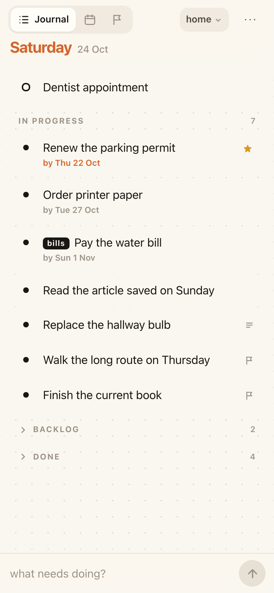
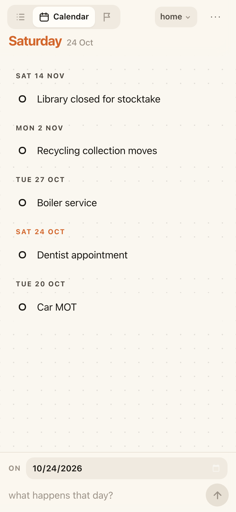
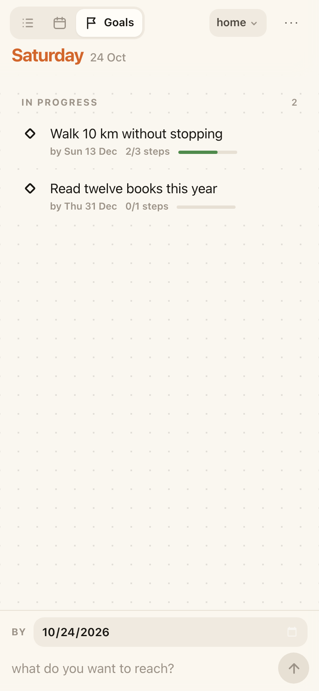
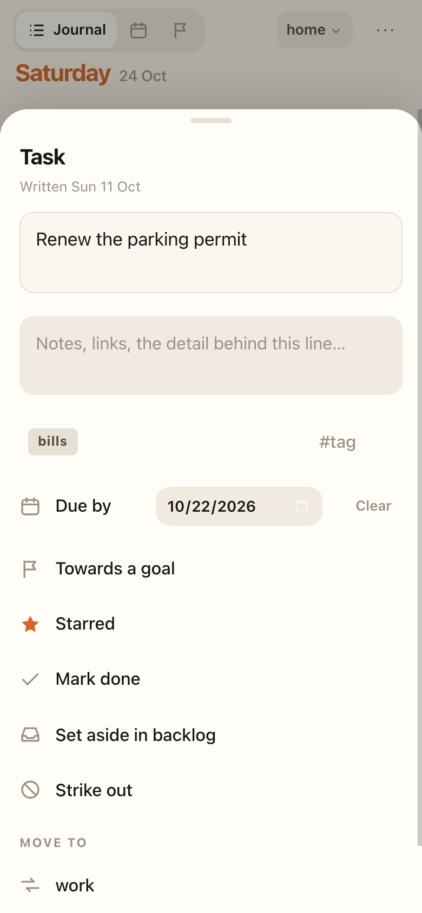

# bujo

A touch-first bullet journal in four pages. Tasks share one endless
**Journal** and may carry a due date; events have a date and live on the
**Calendar**; goals have a due date and live on **Goals**, counting the tasks
that get them done; **Tags** reads across all three, one group at a time.
Switching between the four is the only navigation there is.

No build step, no dependencies, no account. The journal lives in
`localStorage` on the device.

| Journal | Calendar | Goals | A line, opened |
| :-: | :-: | :-: | :-: |
|  |  |  |  |

All four are the light theme — paper; there is a dark one too, the same page
at night. The screenshots are taken from a seeded journal, not a real one.

## What it is

```
  •  a task        something to do, whenever — or by a day
  ○  an event      something that happens, on a day
  ◇  a goal        somewhere to get to, by a day
  ×  done
  ≡  carries notes
```

Three kinds of line, and the page you are on decides which you are writing. A
**task** goes on the Journal, newest first, until you drag it somewhere else
or give it a day it is wanted by. The row prints only its words and that day,
if it has one; the day the line was written is in its sheet. An **event**
always carries a date, and that is what makes it an event; it goes on the
Calendar. A date and no clock — an event is placed on a day, and the day
heading it sits under says which. A **goal** carries a deadline and the tasks
that get it done, and goes on Goals.

A task is something to do whenever, or by a day; an event is something that
happens on a day. A line never moves between the pages — changing what kind of
thing it is would be writing a different line — though the Journal does *show*
you today's events, at the top, where they are hard to miss, and a goal's
steps are ordinary tasks living on the Journal rather than a fourth kind of
line. Tags is the fourth *page* but not a fourth home: nothing is ever written
only to it, and a line on it is the same line the Journal or the Calendar
holds.

There is no free-standing note. **Every line carries its own notes** instead —
open a line and write underneath it — so what you want to remember lives with
the thing it is about rather than floating loose on the page. A line that
holds notes is marked `≡`; the notes themselves never appear in the list,
because a line stays one line.

A task set aside in the backlog keeps its ordinary `•`. The Backlog heading
already says where it is, and a second glyph only competed with the one
distinction that matters: whether the line is still open.

## Using it

**Writing.** Type at the bottom and press return. There is nothing to pick:
the Journal writes a task, and the Calendar writes an event and asks for the
day it falls on, because an event without one is not an event. The Calendar
reads back from the furthest day towards the oldest; several events on one day
sit newest-written first.

**Gestures.** Tap a bullet to complete a line. Swipe a row **right** to
complete it, **left** to set it aside — which for a live task means the
backlog, and for anything else means striking it out. Tap the text to open
everything else.

**Due dates.** A task does not need one — most are just things to do — but
open a line and you can give it a day it is wanted **by**, and take it off
again with *Clear*. The row then prints that day under its words, in orange
once it is past. In Progress and the Backlog read by deadline — anything
overdue at the top, then the soonest day, then the rest, with every undated
task below the dated ones. A date is the one order on the page you do not set
by hand: a line climbs as its day comes. Done is the record rather than the
work, so a deadline no longer sorts it.

**Reordering.** Hold a task still for a moment until it lifts, then drag it up
or down. A line moves within its own bucket — In Progress, Backlog, Done — and
among its own kind, starred or not, since stars always sit on top. Where the
deadline sorts the bucket it is one more such line, so a dated task drags
among the tasks due the same day. A line you write afterwards still lands at
the top.

**Notes on a line.** Tap a line to open it and write underneath — links, the
detail, the questions behind it. Strike a line out when it stops being worth
keeping; delete it when it was never worth writing.

**Today, at the top.** Whatever is on the Calendar for today is printed at
the head of the Journal, under the date stamp that names the day, with a
hairline below it closing it off from the undated work. The event still lives
on the Calendar — this is a read of it, not a second copy — so completing or
striking it there and here are the same act. Nothing on today, nothing shown.

**The backlog.** Tasks you are not doing now but have not given up on. It sits
folded at the foot of the Journal with a count; tap the heading to open it, and
set a line aside or pull it back from the swipe or the entry sheet. A finished
task has no backlog to go to.

**Tags.** Write `#home buy a doorstop` and the line carries a `#home` chip —
three to five lowercase letters, one tag per line, so a chip can never wrap.
On the three kind-pages a tag is only a label on the row: those pages stay one
flat list in the order you wrote it, rather than being cut into a section per
tag. Reading a group whole is what the **Tags** page is for. It opens on every
tag in the notebook with a count each, in the order they were first written;
tap one and you get everything carrying it — tasks, then the backlog, then
events, goals, and one Done fold at the foot — which makes it the only page
that mixes the three kinds of line, because a group is a group whatever its
lines happen to be. The pencil beside a tag renames it across the whole
notebook at once.

A tag picked there stays in hand: step to the Journal, Calendar or Goals and
that page is narrowed to the group, with a chip above the list to put it back
down. Writing a line while a tag is in hand gives it that tag — otherwise it
would land somewhere you cannot see.

**Goals.** On the Goals tab, write what you want to reach and pick the day it
is due *by*. Its sheet opens straight on the field for the first step. Each
step is an ordinary task, so it also lands on the Journal — marked with a
small flag — and is completed there like anything else. You can also add a
task you have already written, or pick a goal from a task's own sheet. A
goal's row shows its deadline and how many of its steps are done; past the
deadline it turns orange. Finishing the last step asks whether the goal is
achieved rather than deciding for you, since there may be steps you have not
written yet. Deleting a goal deletes its steps with it; Undo brings back both.

**Starring** lifts a line to the top of its bucket, above every unstarred one.

**Notebooks.** Several journals in one app — work, private — with one open at a
time, named in the header. A notebook is a *filter*, not a container:
archiving one keeps every line it holds and only takes it out of the picker. Up
to six open at once; archived ones don't count. Move a single line between them
from its entry sheet.

**Search** (**⋯ → Search**, or `f`) looks across *every* notebook, line and
note — you search because you forgot where something is, and the notebook is
part of what you forgot. A hit jumps to the right page and notebook.

**Logged lines** can be hidden wholesale from **⋯ → Logged lines**, which is
the pressure valve for an endless page.

**Keys.** `←` `→` switch pages, `/` focuses the composer, `f` searches, `Esc`
closes a sheet.

## Your data

The journal lives in `localStorage` on the device, and nowhere else. Nothing is
sent anywhere; there is no account and no network call. **⋯ → Export journal**
writes a `bujo-YYYY-MM-DD.json` you can keep, and **Import journal** reads one
back — that's also how you move between phone and desktop.

```json
{ "v": 2, "theme": "auto", "text": 1, "view": "journal",
  "books": [{ "id": "b1", "name": "journal" }],
  "book": "b1",
  "entries": [
    { "id": "k3f9a1", "type": "task", "text": "Book the flights",
      "state": "open", "star": true, "tag": "trip", "due": "2026-10-27",
      "notes": "Check the consulate hours first", "created": 1756000000000 },
    { "id": "k3f9a2", "type": "event", "text": "Flight to Dubai",
      "date": "2026-11-02", "state": "open", "star": false,
      "created": 1756000000001 },
    { "id": "k3f9a3", "type": "goal", "text": "Run a half marathon",
      "due": "2026-12-13", "state": "open", "star": false,
      "created": 1756000000002 }
  ]}
```

`state` is `open`, `done` or `dropped`. `type` is `task`, `event` or `goal` —
nothing else. `date` appears on events and only on events; there is no time of
day. `due` is a deadline rather than a day something falls on: always on a
goal, optional on a task, absent when the task has none. `goal` on a task is
the id of the goal it is a step towards, in the same notebook.
`backlog: true` marks a task set aside. `book` is absent for the first
notebook, which is how a journal written before notebooks existed needed no
migration — and a field the app does not recognise is kept as it was, so an
export from a newer version survives a trip through an older one.

## Coming from the dated journal

The first time this version opens on a device holding a `bujo.v1` journal, it
migrates it once and shows a summary of what moved. The rules:

| old | new |
|---|---|
| task | Journal — the date is dropped, `created` already records when it was written |
| a free-standing note | becomes a task, words, tag and notes intact |
| event with a date | Calendar — the date is kept, the time of day is dropped |
| event with no date | becomes a task; a calendar has nowhere to put it |
| Someday tasks | the backlog, which is what that collection was for |
| `moved` stubs (`›`) | discarded — they pointed at dated pages that no longer exist |
| `doing` | `open`; board pages were the only place it could be set |
| repeating rules | the rule is stripped and the line stays as one ordinary task |

Notebooks, tags, stars, per-line notes, theme and text size all carry over.
Page size (day/week/fortnight) is gone, so notebooks lose it.

Old notes arrive as ordinary tasks, sitting on the page where you can see
them: they are not actionable, so expect to strike out or delete a few. That
is deliberate — filing them somewhere tidy would have meant never reading them
again.

Repeats generated their occurrences on the fly rather than storing them, so a
series collapses to a single line; occurrences you had actually completed are
real entries and are kept as history. **The old `bujo.v1` key is never written
to or cleared** — it stays on the device as the backup, and the summary is
still readable afterwards from **⋯ → What was migrated**.

## Running it

Four files and three PNGs, served by any static host. Locally:

```sh
cd web
./serve.sh          # prints the LAN URL; open it on your phone
./serve.sh 9000     # or pick a port
```

*Add to Home Screen* and offline mode need HTTPS or localhost, so over the LAN
you get the app but not the installable layer. Pushes to `main` that touch
`web/` deploy to GitHub Pages automatically.

## Files

| file | |
|---|---|
| `index.html` | the shell — header, tabs, list, composer, sheet, toast |
| `styles.css` | the paper: colour tokens, dot grid, both themes, the type scale |
| `app.js` | store, migration, dates, render, gestures, sheets |
| `sw.js`, `manifest.webmanifest`, `icons/` | the installable/offline layer |
| `serve.sh` | LAN dev server (no-store headers) |

## Design notes

The look comes from the physical object: warm paper, a dot grid you can
actually see, and one accent that only ever means *this is now*. Dark mode is
the same page at night, so every colour is a token redefined in one block.

The model is deliberately thin. There is one array of entries; the notebook
narrows it and the type of a line decides its page. Neither filter ever
rewrites an entry, which is why a notebook can be archived without touching
what it holds, and why the whole store is small enough to read in one sitting.
