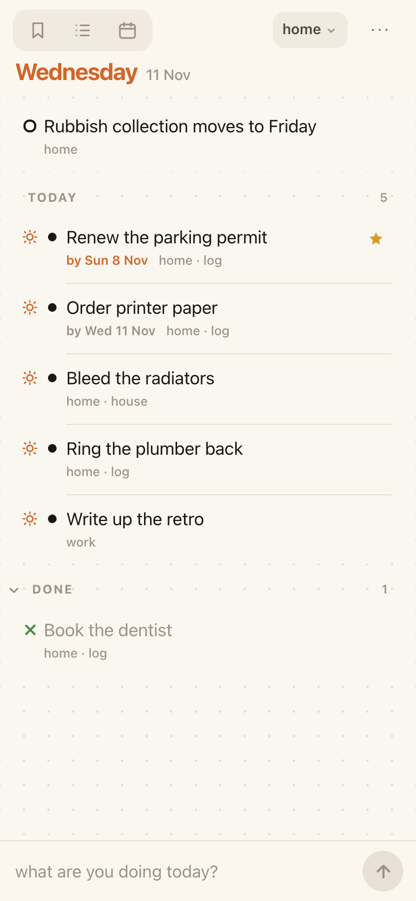
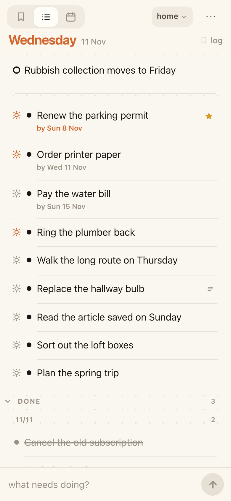
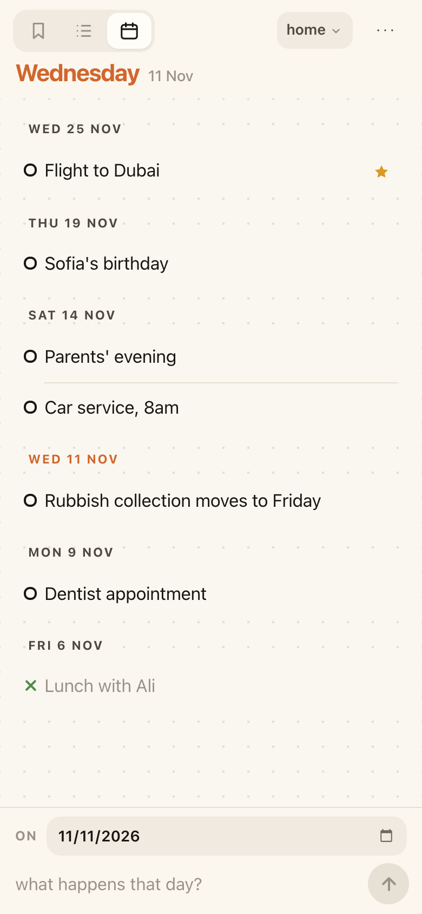
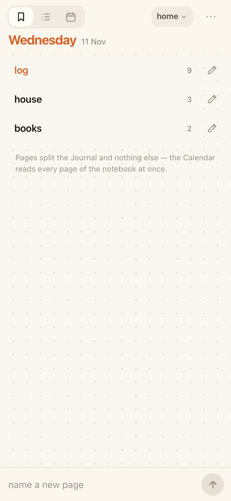
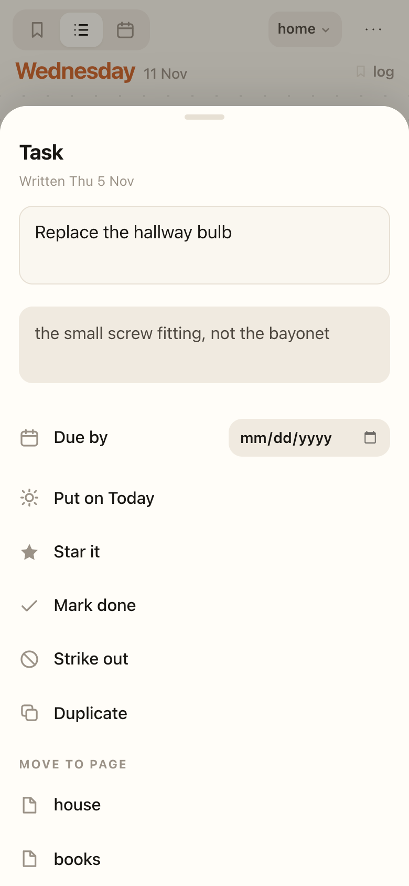

# bujo

A touch-first bullet journal in four pages. **Today** gathers what this day
holds, from every notebook at once; tasks sit on a page of the **Journal** and
may carry a due date; events have a date and live on the **Calendar**; the
**Index** lists the pages of the notebook and turns to any of them. Switching
between the four is the only navigation there is.

No build step, no dependencies, no account. The journal lives in
`localStorage` on the device.

| Today | Journal | Calendar | Index | A line, opened |
| :-: | :-: | :-: | :-: | :-: |
|  |  |  |  |  |

All five are the light theme — paper; there is a dark one too, the same page
at night. The screenshots are taken from a seeded journal, not a real one.

## What it is

```
  •  a task        something to do, whenever — or by a day
  ○  an event      something that happens, on a day
  ◐  set aside     a task in the backlog, begun and put down
  ×  done
  ≡  carries notes
```

Every row starts with the same one-rem column holding that mark, so the words
line up down the whole page whichever list you are reading, and the mark is
always a thumb away. A task struck out keeps its `•`, dimmed and ruled
through: that is a line you decided against, not a state of the work.

Two kinds of line, and the page you are on decides which you are writing. A
**task** goes on the Journal, newest first, until you drag it somewhere else
or give it a day it is wanted by. The row prints only its words and that day,
if it has one; the day the line was written is in its sheet. A row is **one
line high whatever is on it** — words longer than the width end in `…` rather
than wrapping, so what a line costs on the page does not depend on how much
was typed into it, and the whole of it is one tap away in its sheet. An **event**
always carries a date, and that is what makes it an event; it goes on the
Calendar. A date and no clock — an event is placed on a day, and the day
heading it sits under says which.

A task is something to do whenever, or by a day; an event is something that
happens on a day. A line never moves between the pages — changing what kind of
thing it is would be writing a different line — though the Journal does *show*
you today's events, at the top, where they are hard to miss.

Two of the four pages hold no lines of their own. The **Index** is the
notebook's own contents, and the way to turn to another of its pages.
**Today** is the one page that is not about a place at all: every other page
narrows the journal by where a line lives — which notebook, which page, which
of the two kinds — and Today narrows it by *when*, so it reads straight across
all of them.

There is no free-standing note. **Every line carries its own notes** instead —
open a line and write underneath it — so what you want to remember lives with
the thing it is about rather than floating loose on the page. A line that
holds notes is marked `≡`; the notes themselves never appear in the list,
because a line stays one line.

A task set aside in the backlog is marked `◐`, a circle filled half way. The
Backlog heading says where it is on the Journal, but a line is also read away
from that fold — in Search most of all — and there the mark is the only thing
that says it is not being worked on. Half filled because that is what the
backlog is: a line begun and put down, between the task's filled dot and the
nothing it would be if you had never started. In full ink rather than grey —
a shape carries across a list, a shade does not, and the heading above it is
what says the pile is quiet.

## Using it

**Writing.** Type at the bottom and press return. There is nothing to pick:
the Journal writes a task, the Calendar writes an event and asks for the day it
falls on, because an event without one is not an event, and Today writes a task
already marked for today. The Calendar reads back from the furthest day towards
the oldest; several events on one day sit newest-written first.

**Gestures.** Tap a line's mark to complete it or, on one already finished,
to reopen it. Tap the text to open everything else. Swipe a row **right** to
finish it. Swipe it **left** a short way and it stops against a tray of three
actions; carry the swipe **all the way left** and
it goes straight past them to setting the line aside, so the tray is a stop on
the journey and takes no gesture away. A row with a tray open is shut by
tapping it, or by touching any other row — only one is ever open.

**The tray.** Under the right edge of every line on the two lists you work
from — the Journal's live work and Today's wanted lines — in the order you
reach for them:

```
  ⊘  strike out      ▣  set aside      ⧉  duplicate
```

Finishing is not among them: the bullet's tap says it and so does the right
swipe, and a third door onto it here would read as one more thing the left
swipe might be about to do. Three also leaves more of the words showing
beside the open tray — each button costs a thumb's width of them.

**Quick actions.** A task you are working on carries a **sun** at the head of
the row, before its mark, which puts the line on Today (lit while it is on;
tap again to take it off). Only the work in progress: a line you have set
aside is not one you are deciding the day of — Today drops a backlogged line
whatever its mark says — and a line already finished has no next day.

A row without a sun holds nothing in its place, so the Backlog and the Done
begin at the edge of their cards and the work in progress is the one bucket
indented. That indent is the sun, not decoration: the rows you can still do
something about are the rows that step in. The mark itself is always the
same step from the words it belongs to, which is why the sun leads rather
than sitting between them.

The sun says whether the line is on Today, not whether you put it there — so
it is lit on every line of the **Today** page, and tapping it takes that line
off, whatever carried it on. For a line you marked, dropping the mark is
enough. For one the calendar sent — due today, or late — the deadline is
still true and would simply put it back, so the tap records that you said
*not today*, and that is all it records: **the deadline itself is never
touched**. The dismissal keeps the day it was made, the same way the mark
does, so midnight ends it and a line still owed is back tomorrow.

**The work has no heading.** Open the Journal and every live task on the page
is simply there, under the date, in deadline order — naming that pile would
only have told you the lines under the name were the lines you were already
reading, and a fold over it would have hidden the one thing you came for.
Today's events still lead, with a hairline closing them off from the work
where both are on the page.

**Folding.** The two headings below the work — *Backlog* and *Done* — are
folds: tap the word to put their lines away, and the chevron beside it turns
to say which way it is set. The count stays either way, so a closed bucket
still says how much is in it. Done opens each time you come back and the
Backlog starts closed, because it is not what you came to the page to read;
what you fold away is forgotten when you leave, since a fold you did not set
this session is a trap. Today's own heading does not fold — what is on that
page is there because of the day, which is not a pile to put away.

**Due dates.** A task does not need one — most are just things to do — but
open a line and you can give it a day it is wanted **by**, and take it off
again with *Clear*. The row then prints that day under its words, in orange
once it is past. The work and the Backlog read by deadline — anything
overdue at the top, then the soonest day, then the rest, with every undated
task below the dated ones. A date is the one order on the page you do not set
by hand: a line climbs as its day comes. Done is the record rather than the
work, so neither the star nor the deadline sorts it — what arranges it is the
day each line was settled on.

**Done, by the day.** Under the one *Done* fold the record is split by day,
most recent first, with each day's own heading and how many lines it holds.
The date reads short there — `11/05`, and `11/05/2025` once it is not this
year — because it is a stamp repeating down the page rather than a day being
named; everywhere else in the app a date still reads `Sat 21 Nov`. Within a
day the lines read back from the one settled last, the order the day actually
went in. A line finished before the app recorded settling dates is filed under
the day it was written, which is where it already sorted.

**Reordering.** Hold a task still for a moment until it lifts, then drag it up
or down. A line moves within its own bucket — the work, Backlog, Done — and
only among the rows the sort would leave it beside, since anything that crossed
a line the sort draws would be put straight back. In the two buckets that read
by deadline those lines are the star and the day, so a dated task drags among
the tasks due the same day and a starred one among the starred. In Done the
line the sort draws is the day, so a finished task drags among the ones settled
beside it — carrying one across a day heading would say it was finished on a
day it was not. A line you write afterwards still lands at the top.

**Notes on a line.** Tap a line to open it and write underneath — links, the
detail, the questions behind it. Strike a line out when it stops being worth
keeping; delete it when it was never worth writing.

**Today.** Tap the date at the top of any page and you get the day you are
standing in, read from *every* notebook and *every* page at once — because a
day is one day whichever journal a line was written in, and having to visit
four pages of two notebooks to find out what today holds would be a worse
notebook, not a tidier one. The date carries it rather than a tab: the tabs
switch between pages *of the notebook*, and Today is the one page that belongs
to no notebook, so it hangs off the one other thing in the header that belongs
to none either. It lights while you are on it, the way a tab does. Four things
land on it: an **event dated today**, a **task due today**, an **overdue
task** — one whose day has passed and is still open — and a **task you marked
for today** by hand, from its sheet. The events lead, under the date stamp
that names the day they fall on; then *Today*, with the overdue at its head
and their dates in orange, then a folded *Done* — what the day came to.

**Only the overdue carry over.** A deadline is a claim on every day after it
until it is met, so a late task follows you onto Today from whichever notebook
and page it lives on, and stays until you finish it, strike it out or set it
aside. Finished today, it moves to Today's *Done* and is gone tomorrow. A hand
mark does not carry over: a task you marked yesterday and did not finish
starts today off the page — you put back what you still mean to do, one tap
from its sheet.

Because it reads across everything, every row says where the line actually
lives: the notebook, and the page of it, but only the part you could not have
guessed — with one notebook open its name is on every row saying nothing, and
the same goes for a page when the notebook has only one.

Nothing moves here and nothing is copied. A line keeps living on its own page
in its own notebook; Today is a read of it, so completing or striking it here
and there are the same act. There is no dragging, because the order is the
deadline and a deadline is the one order in this app you do not set by hand.
Archived notebooks are left out — archiving is putting a journal away.

**Marking a line for today.** Open it and press *Put on Today*. The mark
records the **day you made it**, not a flag, and that is the whole of how it
expires: it counts only while it still reads as today, so midnight takes it off
by itself. Taking a line off records a day in just the same way, which is what
lets a line held there by a deadline be dismissed for the day without the
deadline being rewritten — tomorrow the date speaks again and the line is
back. A line set aside in the backlog drops off Today whatever its mark
says — the backlog is the word for *not now* — and keeps the mark, so pulling
it back puts it straight back on the page. Marking a line that was set aside
pulls it back out: that is the plainer of the two statements, so it wins.

**Today, at the top of the Journal.** Whatever is on the Calendar for today is
also printed at the head of the Journal, under the date stamp that names the day, with a
hairline below it closing it off from the undated work. The event still lives
on the Calendar — this is a read of it, not a second copy — so completing or
striking it there and here are the same act. Nothing on today, nothing shown.

**The backlog.** Tasks you are not doing now but have not given up on. It sits
folded at the foot of the Journal with a count — the one bucket that starts
closed; tap the heading to open it. A line is set aside from its tray, from a
long left swipe or from its sheet, and pulled back out from the sheet. A
finished task has no backlog to go to.

**The Index.** The first tab is the notebook's contents, and the only place
pages are handled: every page of the notebook in order, each with what is
still waiting on it — the open lines you have not set aside, and nothing at
all beside a page with none. Tap a page to turn to it — you land on the Journal,
reading that page — or the pencil beside it to rename or delete it. The field
at the foot names a new page rather than writing a line, because pages are what
this page is made of; you land on the new one, ready to write. It is the same
move the notebook button in the header makes, one level down.

**Page groups.** A notebook with a dozen pages reads better with headings over
them, so a page can be put under one from its own sheet — *Group*, then a group
that already exists or *New group*. The Index then lists the ungrouped pages
first, the default among them, and each group under a heading you can fold away
like the Backlog.

A group is only a **name written on the pages that carry it**. There is no
group to make before you can use one and none left over when the last page
walks out of it: name one on a page and it exists, take it off the last page
and it is gone. The pencil on a heading renames the group — which writes the
new name onto each of its pages at once — or dissolves it, which takes the name
off and leaves every page exactly where it was.

A group **never filters anything**. It is a heading in the Index and nothing
more: the Journal still reads one page, the Calendar still reads the notebook
whole, and no line moves or changes when a group is made, renamed or dissolved.
Folding one is a this-session thing, like every other fold in the app.

**Starring** lifts a line to the top of its bucket, above every unstarred one.
Done is the exception: a star is about what to do next, so once a line is
finished it sorts by the day it was finished and nothing else.

**Notebooks.** Several journals in one app — work, private — with one open at a
time, named in the header. A notebook is a *filter*, not a container:
archiving one keeps every line it holds and only takes it out of the picker. Up
to six open at once; archived ones don't count. Move a single line between them
from its entry sheet.

**Pages.** Inside a notebook, up to sixteen pages — the tabs down the edge of
a paper one. The **Index** is where they live: turn to one, rename or delete it
with the pencil, name a new one in the field at the foot. Every notebook has a
**default page**, the first in the list: it is where a line with no page of its
own lives, which is how a journal written before pages existed needed no
migration. Any page can be deleted, the default one included — the next along
takes the role, and the lines go with the page the way they do with a notebook.
The one page a notebook cannot be without is its last.

Pages split the **Journal** and nothing else, and the Journal says which page
it is reading: the name sits at the end of the date, under a ribbon, so the
lines below it are never anonymous. The Calendar belongs to the notebook and
reads every page of it at once, because a day is something you want whole —
having to check five pages to find out what is on today would be a worse
notebook, not a tidier one. Today goes one further and reads every page of
every notebook. None of those three names a page on its stamp, for the same
reason: it would say something untrue about what is below it. Today names one
on each row instead, where it is true. Move a task between pages from its entry sheet; moving it to another
notebook lands it on that notebook's default page.

**Duplicate** on a task's sheet writes the same line again on the same page
of the same notebook — its words, notes, star and deadline come with it — and
the copy starts open even if the original was done or struck out, so it is
also how you set out to do a finished thing again. Undo takes it back.

A page is named in **lower case**, whatever you type: it is a tab down the
edge of the notebook rather than a title, and *Work*, *work* and *WORK* are
the same page by any reading — three of them in the Index would only leave you
guessing which one a line went to. A notebook keeps the case you gave it; that
name is the journal's own.

A notebook is named in **five characters or fewer**. That is the feature, not
a limit worked around: it shares one header row with three tabs and a menu, and
a name that gets truncated there is not a name. A page has no such limit — it
is read on a row of its own in the Index, on the stamp above the Journal and in
the move-a-line rows, and each of those gives it the width or trails it off
with an ellipsis. Short still reads better; it is just no longer enforced.

**Search** (**⋯ → Search**, or `f`) looks across *every* notebook and page,
line and note — you search because you forgot where something is, and which
notebook and which page are part of what you forgot. A hit jumps to the page
the line lives on, and to the right page of the right notebook.

**Logged lines** can be hidden wholesale from **⋯ → Logged lines**, which is
the pressure valve for an endless page.

**Keeping the screen awake.** **⋯ → Screen → Stay on** holds the display lit
while bujo is open and in front of you — for the afternoon you are working off
the page rather than at it. It is **off by default**, and meant to be turned
back off: a notebook gets left face-up on a desk, and a screen that never slept
there would flatten the battery. The lock is handed back whenever you leave the
app and taken again when you come back, so it never outlives the page.

The phone can still refuse, and the usual reason is **Low Power Mode**: iOS
ignores the request outright there, and can take a lock back mid-afternoon the
moment the battery drops into it. If it is refused when you flip the switch,
you get *Couldn't hold the screen on* — the setting stays on, and the next tap
on the page asks again, so turning Low Power Mode off and carrying on is all it
takes.

The row only appears where it can work. The browser hides the API on an
insecure origin, so you will see it on the deployed site and on `localhost` but
not over the LAN dev server — the same boundary as *Add to Home Screen* and
offline mode. Safari has had it since 16.4, so iPhones are covered, in the
browser and installed.

**Keys.** `←` `→` switch pages, `/` focuses the composer, `f` searches, `Esc`
closes a sheet.

## Your data

The journal lives in `localStorage` on the device, and nowhere else. Nothing is
sent anywhere; there is no account and no network call. **⋯ → Export journal**
writes a `bujo-YYYY-MM-DD.json` you can keep, and **Import journal** reads one
back — that's also how you move between phone and desktop.

```json
{ "v": 2, "theme": "auto", "text": 1, "awake": false, "view": "today",
  "books": [{ "id": "b1", "name": "bujo" }],
  "book": "b1",
  "pages": [{ "id": "p1", "book": "b1", "name": "log" },
            { "id": "p2", "book": "b1", "name": "ideas", "group": "side projects" }],
  "page": "p1",
  "entries": [
    { "id": "k3f9a1", "type": "task", "text": "Book the flights",
      "state": "open", "star": true, "due": "2026-10-27",
      "today": "2026-10-27",
      "notes": "Check the consulate hours first", "created": 1756000000000 },
    { "id": "k3f9a2", "type": "event", "text": "Flight to Dubai",
      "date": "2026-11-02", "state": "open", "star": false,
      "created": 1756000000001 }
  ]}
```

`state` is `open`, `done` or `dropped`. `type` is `task` or `event` — nothing
else. `date` appears on events and only on events; there is no time of day.
`due` is a deadline rather than a day something falls on: optional on a task,
absent when it has none. `today` is the hand mark for the Today page and stores
**the day the mark was made** rather than `true`, which is how it expires on
its own at midnight with nothing written back; it is absent on a task that was
never marked and on every event, since an event's `date` already says which day
it is on. `backlog: true` marks a task set aside. `settled` is when a line was
finished or struck out, and is both what orders the Done stack, most recent
first, and the day its heading there prints; it is absent while a line is open,
and absent as well on a journal written before the field existed — such a line
falls back to `created`, exactly as it did then. The days themselves are
nowhere in the file: they are read off the lines, so there is no day to go
stale when the last line settled on one is reopened or deleted. `book` is absent for the first
notebook, which is how a journal written before notebooks existed needed no
migration; `page` is the same trick one level down — it appears on tasks only,
and is absent for its notebook's default page. `group` is the trick one level
down again: a page carries the name of the group it is under, and absent means
it is under none, so there is no list of groups anywhere in the file — and a field the app does not recognise is kept as it was, so an
export from a newer version survives a trip through an older one.

## Coming from the dated journal

The first time this version opens on a device holding a `bujo.v1` journal, it
migrates it once and shows a summary of what moved. The rules:

| old | new |
|---|---|
| task | Journal — the date is dropped, `created` already records when it was written |
| a free-standing note | becomes a task, words and notes intact |
| event with a date | Calendar — the date is kept, the time of day is dropped |
| event with no date | becomes a task; a calendar has nowhere to put it |
| Someday tasks | the backlog, which is what that collection was for |
| `moved` stubs (`›`) | discarded — they pointed at dated pages that no longer exist |
| `doing` | `open`; board pages were the only place it could be set |
| repeating rules | the rule is stripped and the line stays as one ordinary task |
| tags | dropped — a tag was a group read on a page this version does not have |

Notebooks, stars, per-line notes, theme and text size all carry over. Page size
(day/week/fortnight) is gone, so notebooks lose it. Every notebook arrives with
its default page and every line on it.

Old notes arrive as ordinary tasks, sitting on the page where you can see
them: they are not actionable, so expect to strike out or delete a few. That
is deliberate — filing them somewhere tidy would have meant never reading them
again.

Repeats generated their occurrences on the fly rather than storing them, so a
series collapses to a single line; occurrences you had actually completed are
real entries and are kept as history. **The old `bujo.v1` key is never written
to or cleared** — it stays on the device as the backup, and the summary is
still readable afterwards from **⋯ → What was migrated**.

## Running it

Four files and three PNGs, served by any static host. Locally:

```sh
cd web
./serve.sh          # prints the LAN URL; open it on your phone
./serve.sh 9000     # or pick a port
```

On Windows, `serve.bat` (or `serve.bat 9000`) does the same from `cmd` or
PowerShell; it needs `python` on the PATH. The first run may raise a Windows
Firewall prompt — allow it on private networks or the phone cannot connect.

*Add to Home Screen* and offline mode need HTTPS or localhost, so over the LAN
you get the app but not the installable layer. Pushes to `main` that touch
`web/` deploy to GitHub Pages automatically.

## Files

| file | |
|---|---|
| `index.html` | the shell — header, tabs, list, composer, sheet, toast |
| `styles.css` | the paper: colour tokens, dot grid, both themes, the type scale |
| `app.js` | store, migration, dates, render, gestures, sheets |
| `sw.js`, `manifest.webmanifest`, `icons/` | the installable/offline layer |
| `serve.sh`, `serve.bat` | LAN dev server (no-store headers), macOS/Linux and Windows |

## Design notes

The look comes from the physical object: warm paper, a dot grid you can
actually see, and one accent that only ever means *this is now*. Dark mode is
the same page at night, so every colour is a token redefined in one block.

The model is deliberately thin. There is one array of entries; the notebook
narrows it, the type of a line decides its page, and on the Journal the page
of the notebook narrows it once more. Today is the one filter that is not a
place at all — it narrows by the day, and so it reads past all three. No
filter ever rewrites an entry, which is why a notebook can be archived without
touching what it holds, why a page is three fields and a convention about
absence, why a mark for today is a date rather than a flag that would need
sweeping, and why the whole store is small enough to read in one sitting.
